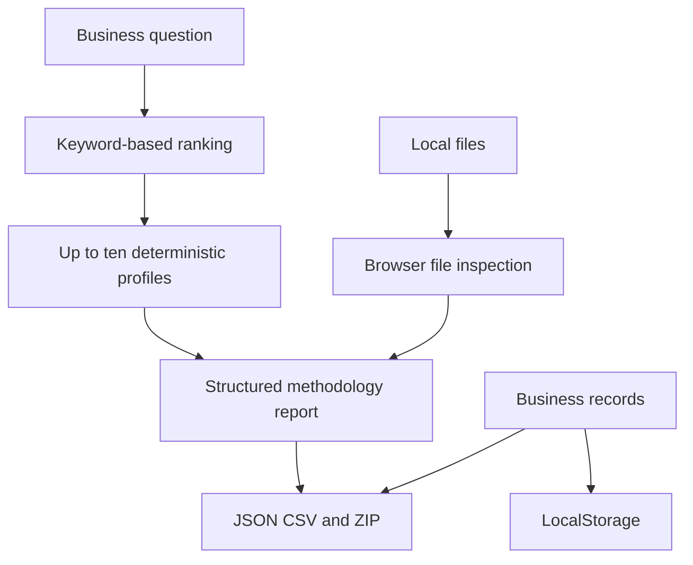

# AutoEntrepreneur 1M — Studio Niko Design

**Browser-based business workspace · Deterministic specialist profiles · Local document tools**

 

[Application GitHub Pages (disponibilité non vérifiée)](https://nikoju1977.github.io/AutoEntrepreneur-1M/) · [Méthodologies](references/) · [English overview](#english-overview)

## Architecture réelle

| Source | Fonction |
| --- | --- |
| [assets/app.mjs](assets/app.mjs) | Catalogue, classement, rapports, outils administratifs et traitement de fichiers |
| [references/](references/) | Bibliothèque de méthodologies |
| [index.html](index.html) | Interface |
| [sw.js](sw.js) | Cache PWA |

Le million de profils est un espace combinatoire adressable, calculé à partir d'un identifiant, pas un million de processus, de modèles ou de personnes. `rank` sélectionne les domaines par mots-clés ; `solve` compose un rapport méthodologique déterministe. Les échanges du rapport représentent un scénario de coopération, pas des messages entre LLM autonomes.

Application PWA pour les auto-entrepreneurs : catalogue de profils spécialistes, coopération de **1 à 10 agents**, socle de gestion d'entreprise, bibliothèque de méthodologies, import de fichiers et outils de contrôle qualité.

## Ouvrir

Après activation de GitHub Pages : https://nikoju1977.github.io/AutoEntrepreneur-1M/

L'application peut être installée depuis un navigateur Android, iOS ou ordinateur. Le contenu statique est mis en cache pour fonctionnement hors ligne après une première visite connectée.

## Fonctionnement

- Catalogue combinatoire de **1 000 000 de profils** (50 domaines × 20 spécialisations × 20 rôles × 50 approches). Dix profils maximum travaillent sur une mission.
- Bibliothèque métier locale pour chaque discipline et base commune de gestion d'entreprise.
- Rapports traçant les échanges méthodologiques entre agents, sans modèle d'IA générative connecté.
- Import de fichiers et de dossiers selon compatibilité navigateur. Inspection locale des médias et lecture des documents texte courants.
- Exports structurés, PDF par impression, récupération des originaux.

**Limites :** cette version ne lance pas un million de modèles ni dix LLMs indépendants ; les agents sont des profils et règles métiers déterministes. Les recommandations nécessitent une validation par un professionnel qualifié pour les décisions réglementaires ou sensibles.

## Confidentialité

Les pièces importées restent dans la session du navigateur et ne sont pas envoyées sur un serveur. Ne pas utiliser comme coffre-fort documentaire permanent.

## Déploiement

Le dépôt contient un workflow `.github/workflows/pages.yml` pour publier via GitHub Pages si la fonctionnalité GitHub Pages est activée et configurée pour **GitHub Actions** dans les paramètres du dépôt.

## Qualification proposée

Servir le dépôt avec `python3 -m http.server 8000`, puis ouvrir http://localhost:8000/. Utiliser uniquement des fichiers et données administratives fictifs.

- Vérifier les deux bornes du catalogue, les identifiants invalides et la limite de dix profils.
- Comparer un rapport généré aux domaines effectivement sélectionnés.
- Vérifier les exports, leur contenu et la présence éventuelle des originaux dans le ZIP.
- Comparer les calculs de trésorerie à un calcul indépendant ; les cotisations sont des hypothèses saisies, pas un calcul fiscal certifié.
- Vérifier la restauration et la confidentialité. Les paramètres, missions et registres sont stockés dans localStorage sans chiffrement applicatif établi ; les fichiers originaux restent en session.

Aucun de ces essais n'a été exécuté pour cette révision. Les références réglementaires et les obligations de facturation doivent être vérifiées séparément avant usage professionnel.

## English overview

AutoEntrepreneur 1M is a deterministic business workspace with one million addressable combinations of specialist profiles, up to ten selected profiles per mission, keyword-based ranking, structured reports, local file inspection and administrative tools. It does not run a million AI models or ten independent LLM agents. Browser storage is not encrypted by the application and documents may be included in exported archives. Financial outputs are indicative, not tax or legal advice. No new runtime, deployment or regulatory verification was performed.

## Licence et contribution

[LICENSE.md](LICENSE.md) : droits réservés pour les contributions originales concernées ; aucun changement de licence. Les droits des composants tiers restent applicables. Rapporter les anomalies avec des données fictives.

**Studio Niko Design** · Deterministic business tooling and transparent methods.
